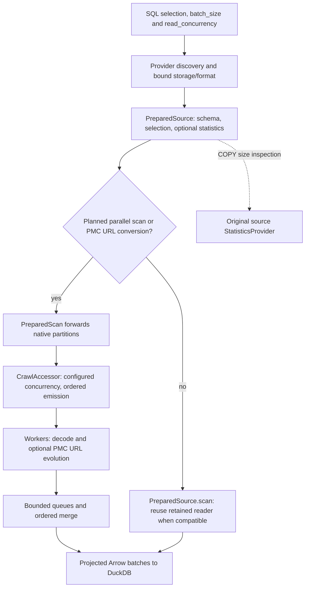

# Architecture

DuckPort is a SQL and Arrow C ABI adapter around two reusable Rust projects.

| Component | Responsibility |
| --- | --- |
| DuckDB | Query planning/execution, SQL types, native readers, COPY integration, secret storage and profiling |
| [open-arrow-access](https://github.com/dentiny/open-arrow-access) | Byte access, format/service readers, attachment decoding, prepared sources and projected Arrow streams |
| [open-arrow-sink](https://github.com/dentiny/open-arrow-sink) | Writer sessions, commits/aborts, capabilities, blob downloads, schema remapping and backend implementations |
| DuckPort C++ | Function registration, typed option binding, per-URI secret lookup, source metadata and Arrow export/import |
| DuckPort Rust | Owned async state, policy/credential adaptation and synchronous C entry points on a shared Tokio runtime |

## Reading

C++ binds `duckport_scan_*` and passes borrowed strings/options to Rust. The
shared `export_reader!` declaration macro only supplies the C signature and
`open_reader` call; provider logic stays in `rust/src/readers/<provider>.rs`.
Rust prepares an upstream `PreparedSource`, exposes its schema at bind time, and
produces projected streams through `BlockingRecordBatchReader` and Arrow C ABI.
A full projection can reuse the prepared reader. Empty projections retain row
counts for COUNT(*). SQL filters remain in DuckDB.

`SelectedAttachment` shares SQL attachment parsing across providers, while the
upstream `AttachmentAccessor` owns decoding and provider file membership.
OAI-PMH selection/pagination is in `oai.rs`; ATIF URI policy is in its reader
module. arXiv's metadata module loads one Parquet snapshot and delegates ID
normalization and PDF matching to `ArxivMetadataIndex`.

### Shared crawl execution

`DuckportSource` retains an upstream `PreparedSource` for schema/projection,
source statistics and independent readers. Its execution path uses `CrawlAccessor`
when a source exposes native partitions and the requested concurrency is greater
than one. PMC shard XML/TXT URL selection uses the same path even at concurrency
one, with one shared schema-evolution plan running inside partition workers.

DuckPort explicitly sets crawl concurrency from SQL/COPY and native batch prefetch
to one, preserving its previous execution budget. It requests ordered emission
for every reader, honoring HF's global-order requirement and preserving MECA
manifest order. The
upstream per-streaming-file read-ahead budget stays at 8 MiB. Extra coalescing and
merged prefetch remain disabled; no extra SQL settings or merged-stream prefetch
queue are introduced. Existing byte options, secrets, HTTP clients and storage policy remain
bound to the source. Parallel planning can repeat source discovery after schema
binding; `PreparedSource` retains a schema, not a source-membership snapshot.

Common Crawl release/segment, HF exports, CourtListener and PMC inventory readers
retain their upstream planners rather than erasing them during preparation. Their
provider code supplies selection/configuration; the shared source path owns
execution. arXiv, PMC articles/shards and standard file readers use that same path.

All 14 selected-attachment providers use one `SelectedAttachment` adapter. It
retains `AttachmentAccessor` planning through `DuckportSource::plannable`; the
common execution-time `PreparedScan` then enters `CrawlAccessor::new` with SQL
projection, batch size, concurrency and ordered emission. Provider-specific code
only resolves selection/authentication and supplies the bound byte namespace.
Parquet/text formats retain native partitions; a binary attachment stays one
whole-document partition.

This attachment path uses native attachment planning released in open-arrow-access
0.13.0; all dependencies come from crates.io.

OAI providers use upstream `OaiHarvester` and `LimitLayer` for continuation and
`max_records`, with a small adapter binding SQL selectors. Their
token-dependent continuation chain remains sequential.

See the upstream [crawl workflows and tuning guide](https://github.com/dentiny/open-arrow-access/blob/v0.13.0/docs/crawl.md)
for partition/file budgets, emission policy and HTTP/request amplification.

## Writing

`src/sink/copy_options.cpp` binds COPY options, `copy_query.cpp` handles sampling
and generated expressions, and `copy.cpp` owns planning/execution. Backend
openers live under `src/sink/<backend>/` and `rust/src/sink/<backend>/`.
C++ exports the query schema/batches; Rust opens the selected sink and delivers
batches to its writer. Successful finalization commits; failed writes abort where
supported. Backend publication and cleanup guarantees differ.

The sink crate family includes `open-arrow-sink-core`, `-layer`, `-storage`,
`-lance`, `-parquet` and `-iceberg`. Blob downloading, schema evolution and the
unordered writer pool use their existing layers. Shared storage/format behavior
belongs upstream rather than in a new extension-only framework.

## Credentials and lifetime

C++ resolves secrets on the query thread; Rust receives owned credential
snapshots for background I/O. Writer source credentials and catalog credentials
are independent of destination storage. An arXiv metadata snapshot similarly has
its own `StorageParameters`, resolved against `metadata_uri`.

C strings and option pointers are borrowed only during open. Returned sources,
writers, snapshots and streams own the state needed after that call. C and Rust
option layouts must change together. Arrow release callbacks transfer ownership
across the ABI. Errors are returned as owned strings and freed by the matching
FFI release function.

Native fixtures are a separate test extension. Their server/environment classes
own cleanup through destruction; servers are destroyed before request-handler
state. Shared maps and request traces use DuckDB annotated mutexes and lock
annotations. See the [test guide](../test/README.md).

## Async boundary

Runtime ownership and synchronous `block_on` calls belong only at FFI boundaries.
Internal readers, storage and file discovery expose async APIs and never create
or enter a runtime themselves.
